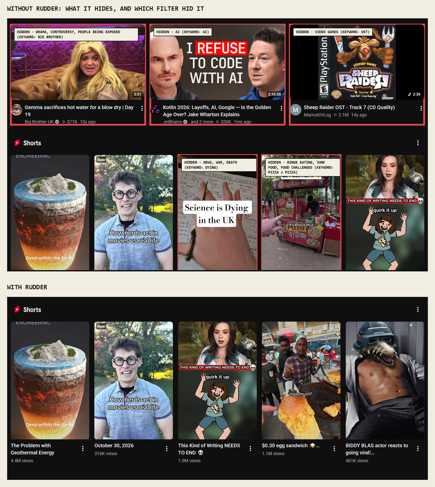
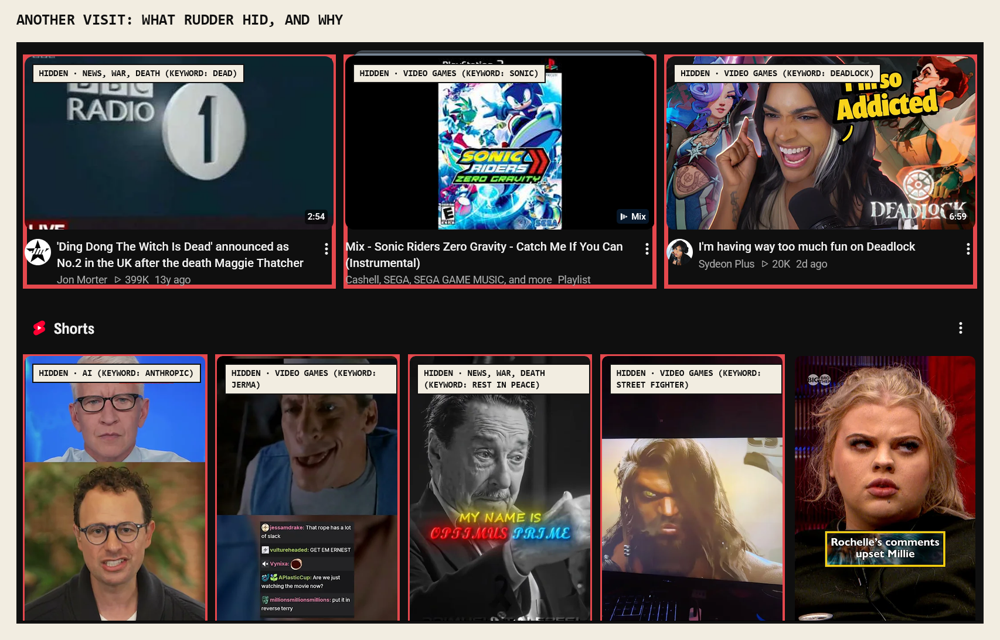
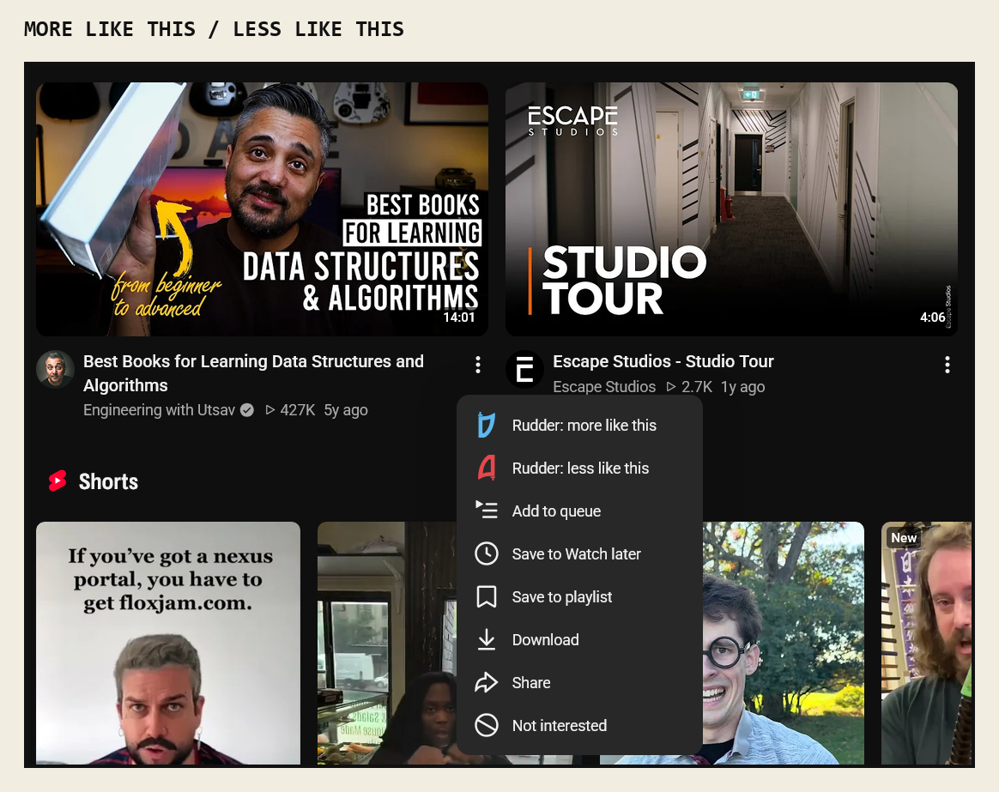
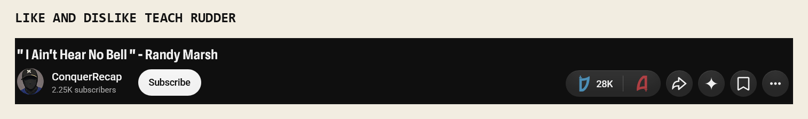
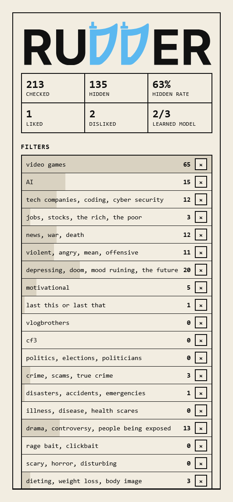

Rudder: Choose what Youtube recommends.

Problem case: Youtube is technology monopoly on video media, they have optimized for cost and infra to just send practically infinite videos to your home page. It is popular consensus that User experience is deteriorating. The whims of old social media are long gone and this has negatively impacted its user base with no where left to go.

Solution: Give configurability to the end user, allowing for a seamless configuration of your own algorithm, capture information and filter it through a set of editable keywords, transformer model activations and a adaptable classifier to determine the information being sent to the end user is acceptable. The client side is altered on the desktop view of youtube so that videos that do not get accepted cannot be shown (including shorts) so that they do not disrupt user experience. This has the suprising benefit of complemenatrily providing Youtube’s algorithms the view of a disciplined user that has a clear preference on which videos that they want to watch. Riding on the wave of its own Machine Learning, Rudder can guide youtube to fix the problem itself.

A control flow of obsfucation of media reappearing the videos is the approach used to manage user experience. There is a goal to not privy the user to the idea that it isnt a natural youtube experience as they do a good job at capturing their audience and garnering a large fan base, so the only addition was the ability to like and dislike videos for Rudder to train a classifier to engage in further personalised filtering that cannot be immediately and easily translated by our end user in creating all the filters they need once setting this up.

Happy Surfing.
